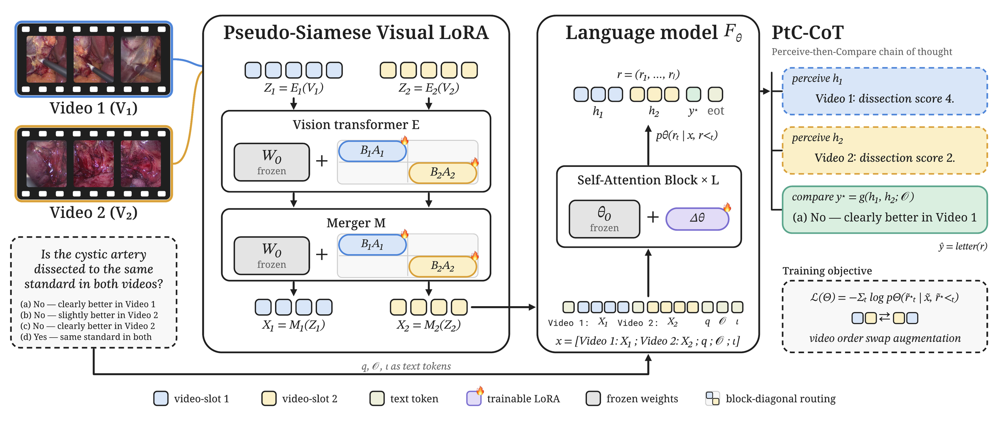

<p align="center">
  <picture>
    <source media="(prefers-color-scheme: dark)" srcset=".github/logo_dark.png">
    
  </picture>
</p>

<h2 align="center">EndoComparer: Comparative Surgical Video Question Answering with<br>Pseudo-Siamese Visual Adaptation and Perceive-then-Compare Reasoning</h2>

<p align="center">
  
  <a href="https://camma-public.github.io/endocomparer/" target="_blank"></a>
  <a href="https://huggingface.co/ethanshili/EndoComparer" target="_blank"></a>
  
</p>

<p align="center">
  <a href="https://xemcerk.github.io/" target="_blank">Shi Li</a><sup>1,2</sup>, <a href="https://lalithnag.github.io/" target="_blank">Lalith Sharan</a><sup>1,2</sup>, <a href="https://scholar.google.com/citations?user=DuYFrSUAAAAJ" target="_blank">Joël L. Lavanchy</a><sup>3,4</sup>, <a href="https://flaick.github.io/" target="_blank">Kun Yuan</a><sup>1,2</sup>, <a href="https://arbua.github.io/" target="_blank">Lorenzo Arboit</a><sup>1,2</sup>, Nabani Banik<sup>1,2</sup>, Elif Yazici<sup>1,2</sup>, <a href="https://scholar.google.com/citations?user=KtS_p1QAAAAJ&hl=it" target="_blank">Maria Vannucci</a><sup>2,5</sup>, <a href="https://vinkle.github.io/" target="_blank">Vinkle Srivastav</a><sup>1,2</sup>, <a href="https://scholar.google.com/citations?user=laTXGpoAAAAJ" target="_blank">Pietro Mascagni</a><sup>1,2,6</sup>, <a href="https://camma.unistra.fr/npadoy/" target="_blank">Nicolas Padoy</a><sup>1,2</sup>
  <p align="center"><sup>1</sup>ICube, University of Strasbourg, CNRS, INSERM, France <sup>2</sup>IHU Strasbourg, France <sup>3</sup>Clarunis, Basel, Switzerland <sup>4</sup>University of Basel, Switzerland <sup>5</sup>University of Turin, Italy <sup>6</sup>Fondazione Policlinico Universitario Agostino Gemelli IRCCS, Rome, Italy</p>
</p>

**EndoComparer** is a vision-language model focused on cross-case surgical video comparison: given two surgical videos from different cases, it answers questions about whether and how they differ in anatomy, tools, actions and skill. It gives each video its own visual encoding and reasoning path, which makes the model more robust and accurate against video-binding confusion, where the content of one video is attributed to the other.

<p align="center">
  
</p>

## 🔥 News

- **[2026.11.04]** ⭐️ Code and model release.

## 🕹️ Quick start

**1. Install**

```bash
pip install -r requirements.txt            
```

**2. Get the base model and the EndoComparer checkpoint**

```bash
hf download Qwen/Qwen3.5-9B --local-dir models/Qwen3.5-9B
hf download ethanshili/EndoComparer --local-dir models/EndoComparer
```

The checkpoint holds the language-model LoRA (`adapter_model.safetensors`) and the Pseudo-Siamese Visual LoRA
(`dual_vision_lora.pt`, `psvl_config.json`); both are loaded onto the frozen base at inference.

**3. Run inference on the demo item**

`demo/` ships one EndoDiffVQA test item: two cholecystectomy clips and the question
*"Is the gallbladder coagulated in both videos?"* with its four options.

```bash
bash scripts/evaluate.sh --jsonl demo/items.jsonl \
    --model models/Qwen3.5-9B --weights models/EndoComparer \
    --out results/demo/results.json
```

The model first states what each video shows, then gives the letter:

```
Video 1: coagulated. Video 2: not coagulated. (b)
```

`results/demo/results.json` holds the record (`id`, `prediction`, `raw_prediction`);

## 🚀 Training

```bash
bash scripts/train.sh --from-dataset --dataset-root data/EndoDiffVQA --out runs/endocomparer
```

## 🔮 Evaluation

```bash
bash scripts/evaluate.sh --dataset-root data/EndoDiffVQA --split test --out results/test/results.json
```

Runs EndoComparer on the test split with the shared frame protocol and writes Detect / Specify / Strict next to the results. Add `--controls full,swap` for the swap control, or `--jsonl items.jsonl` for your own items.

## Citation

To be added.

## License

This repository is released under the Creative Commons Attribution-NonCommercial-ShareAlike 4.0 International (CC BY-NC-SA 4.0) license. See the LICENSE file for details.

## Acknowledgements

EndoDiffVQA is built on [CholecT50](https://github.com/CAMMA-public/cholect50),
[MultiBypass140](https://github.com/CAMMA-public/MultiBypass140) and [CholeScore](https://github.com/CAMMA-public/cholescore). EndoComparer builds on
[Qwen3.5-9B](https://huggingface.co/Qwen/Qwen3.5-9B).
